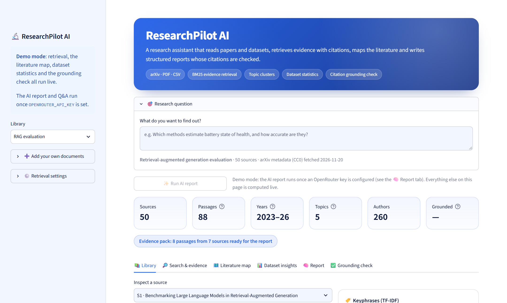
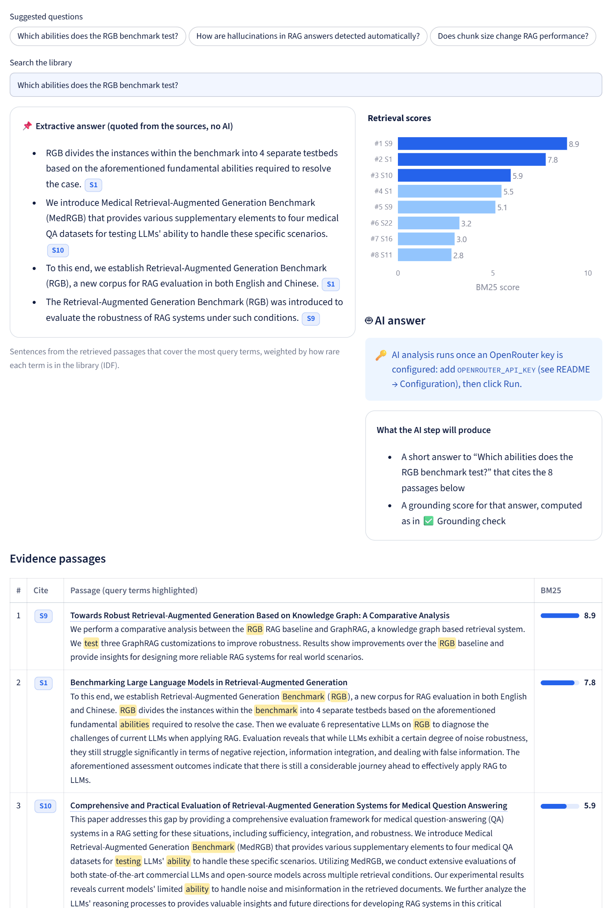
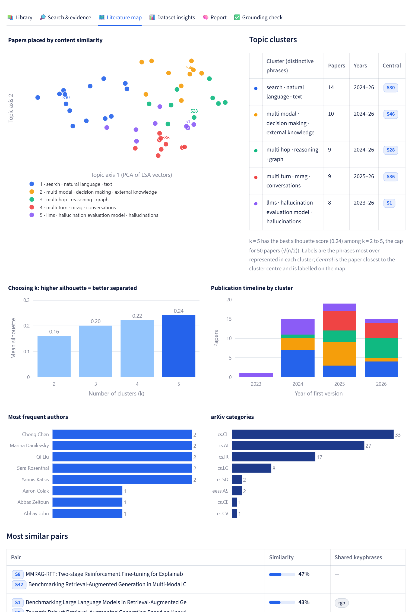
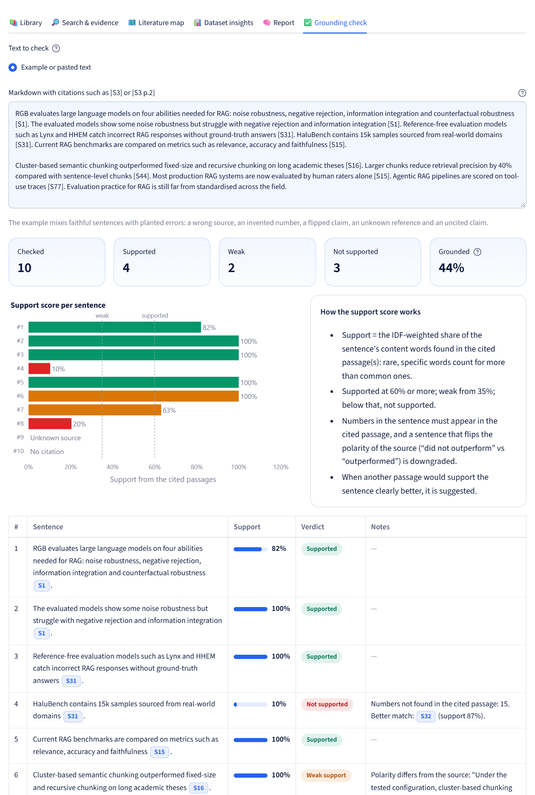
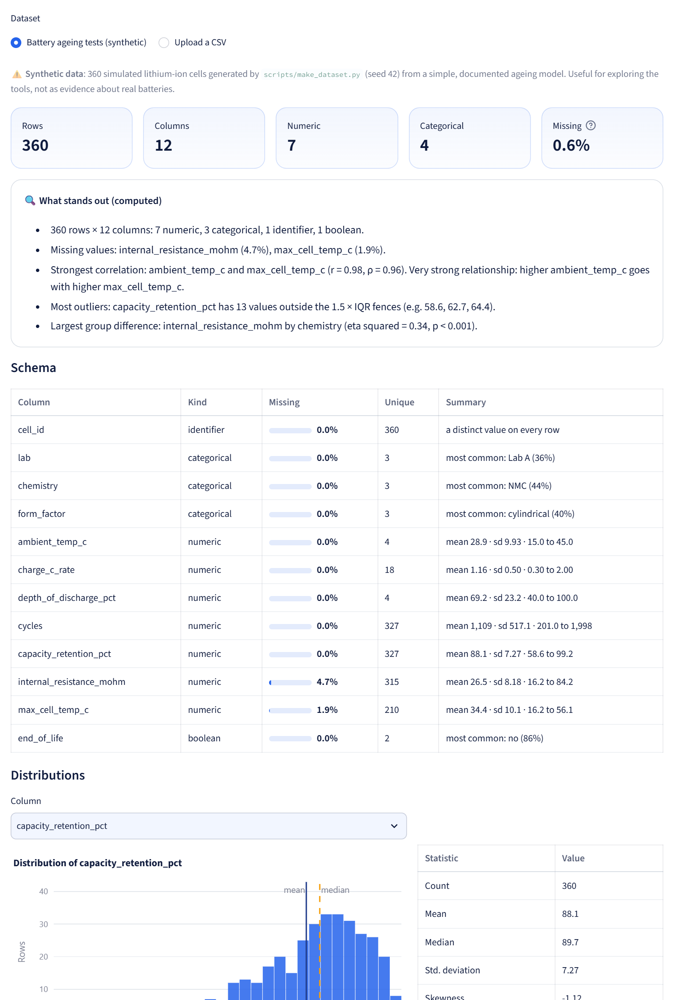
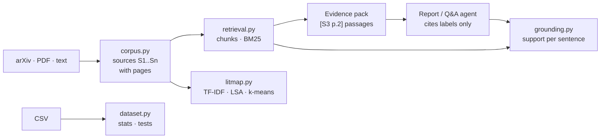

<p align="center">
  
</p>

<p align="center">
  <a href="https://github.com/iamsammy-ak/researchpilot-ai/actions/workflows/ci.yml"></a>
  
  
  
  <a href="LICENSE"></a>
</p>

**ResearchPilot AI** is a research assistant for a literature review. It reads papers (arXiv search, uploaded PDFs,
pasted text) and datasets (CSV), retrieves evidence passages with citations such as `[S3 p.2]`, maps the literature
into topic clusters, runs the basic statistics a dataset needs, and writes a structured report whose citations are
then checked sentence by sentence.

The split is deliberate: **retrieval, clustering, statistics and the citation check are computed in Python.** The
language model only writes from the evidence passages it is given, and its output is checked against those passages
afterwards. Everything except the AI report and Q&A runs without a key, so the app is fully usable in demo mode.
The AI features need a free [OpenRouter](https://openrouter.ai/keys) key.



## Features

| | |
|---|---|
| 📚 **Library** | arXiv search (keyless API), PDF upload with page tracking, pasted text. Every source gets a label (S1, S2, ...) used by all citations |
| 🔎 **Evidence retrieval** | Sentence-aware chunking and BM25 ranking, query terms highlighted, plus an extractive answer quoted verbatim from the sources |
| 🗺️ **Literature map** | TF-IDF keyphrases, cosine similarity, k-means topic clusters with k chosen by silhouette, a 2-D map, timeline, authors and categories |
| 📊 **Dataset insights** | Schema, missing values, distributions, Pearson and Spearman correlations, IQR outliers, Welch's t-test, ANOVA and chi-square, each with a plain-language readout |
| ✅ **Grounding check** | For every cited sentence in any Markdown text: how much of it the cited passage supports, missing numbers, flipped claims, unknown sources and a better-matching source |
| 🧠 **AI report and Q&A** | A structured report (findings, methods, disagreements, gaps, future work) and cited answers, written only from retrieved evidence. Needs an OpenRouter key |
| ⬇️ **Research brief** | Markdown export with the cluster table, evidence, extractive answer, AI report, grounding table and reference list |

## Screenshots

<table>
  <tr>
    <td width="50%"></td>
    <td width="50%"></td>
  </tr>
  <tr>
    <td align="center"><b>Search & evidence</b>: BM25 passages, extractive answer, scores</td>
    <td align="center"><b>Literature map</b>: topic clusters, silhouette, timeline</td>
  </tr>
  <tr>
    <td width="50%"></td>
    <td width="50%"></td>
  </tr>
  <tr>
    <td align="center"><b>Grounding check</b> on a paragraph with planted errors</td>
    <td align="center"><b>Dataset insights</b> on the synthetic battery dataset</td>
  </tr>
</table>

## How it works



1. **Library** (`researchpilot/corpus.py`, `arxiv.py`): arXiv results, PDFs and pasted text become numbered sources.
   PDFs keep their page texts, so a passage from page 2 of source 3 is cited as `[S3 p.2]`.
2. **Retrieval** (`researchpilot/retrieval.py`): text is packed into chunks of whole sentences (about 120 words, 30
   words of overlap) and ranked with BM25. At most two passages per source go into an evidence pack, so one paper
   cannot crowd out the rest.
3. **Literature map** (`researchpilot/litmap.py`) and **dataset insights** (`researchpilot/dataset.py`) are fully
   deterministic.
4. **AI agents** (`researchpilot/agents.py`) receive only the labelled passages and must cite them. The report is
   validated with Pydantic; lenient validators absorb common free-model quirks, and an invalid reply gets one
   automatic repair round-trip.
5. **Grounding check** (`researchpilot/grounding.py`) scores every cited sentence against the passages it cites. It
   works on any Markdown, so you can paste your own paragraph and check it.

### Methods

| Step | Method |
|---|---|
| Tokens | Lowercase words, stop words removed, light suffix stemmer ("evaluation", "evaluated", "evaluating" → "evaluat") |
| Chunking | Whole sentences packed up to the chunk size; trailing sentences repeated as overlap; long sentences split |
| Ranking | BM25 (k1 = 1.5, b = 0.75) with Lucene's IDF, log(1 + (N − n + 0.5) / (n + 0.5)), which stays positive in small libraries; chunks are indexed with their paper's title |
| Extractive answer | Retrieved sentences ranked by the IDF-weighted share of query terms they contain, at most two per source |
| Keyphrases | TF-IDF over 1-3 word phrases that never cross a stop word or punctuation; longer phrases get a 25% boost per extra word |
| Similarity | Cosine similarity of TF-IDF vectors |
| Clusters | LSA (truncated SVD, 6 dimensions, rows normalised), k-means for k = 2 to √(n/2), k with the best silhouette score |
| Cluster labels | Phrases whose mean TF-IDF in the cluster most exceeds the library mean; *central paper* = closest to the centroid |
| 2-D map | PCA of the LSA vectors |
| Correlations | Pearson r and Spearman ρ on pairwise-complete rows, with p-values; strength bands 0.1 / 0.3 / 0.5 / 0.7 |
| Outliers | Tukey fences: below Q1 − 1.5·IQR or above Q3 + 1.5·IQR |
| Group tests | Welch's t-test with Cohen's d (2 groups) or one-way ANOVA with η² (3+ groups); Mann-Whitney U or Kruskal-Wallis as a cross-check |
| Association | Chi-square test of independence with Cramér's V, warning when over 20% of expected counts are below 5 |

### The grounding check

For a sentence that cites passages P, with content terms T (stemmed, stop words removed):

```
support = Σ idf(t) for t in T found in P  ÷  Σ idf(t) for t in T
```

Rare, specific words count for more than common ones. A sentence is **supported** at 60% or more, **weak** from 35%,
and **not supported** below that. Three further checks catch what word overlap misses:

- every number in the sentence must appear in the cited passage (`15k` cited to a paper that never says 15 is flagged);
- the sentence must not flip the polarity of the source sentence it resembles ("outperformed" against "did not
  outperform"); a flip downgrades it to weak;
- if another passage in the library would support the sentence at 60% or more and at least 15 points better, it is
  suggested as the better source.

Citations to labels that are not in the library are reported as unknown, and factual-looking sentences without any
citation are listed too. Each sample library ships with an example paragraph that mixes faithful sentences with
planted errors (a wrong source, an invented number, a flipped claim, an unknown reference and an uncited claim); a
test keeps the checker catching all of them.

### Built for free models

The AI report and Q&A run on OpenRouter's free models and need a free key. The client in `researchpilot/llm.py`:

- tries a list of models in order and **skips a busy model** instead of retrying it, saving the daily quota;
- **caches** every successful reply on disk, keyed by a hash of the request, so a repeat run costs nothing;
- validates JSON against the schema and **repairs once** when a reply is malformed or cut off;
- supports **saved analyses**: `scripts/build_demo.py` writes reports for the sample questions to
  `demo/analyses/<fingerprint>.json`, and the app shows them without a key. A saved analysis is keyed by the question
  and the exact evidence passages, so it is only shown when it was written from the evidence the app retrieves now.
  None are bundled yet; without them, the AI sections explain the setup step and what the AI will produce.

## Data

| Data | Source | Licence |
|---|---|---|
| RAG evaluation corpus | 50 arXiv records (2023-2026) for `abs:"retrieval augmented generation" AND (abs:evaluation OR abs:benchmark)` | arXiv metadata, CC0 1.0 |
| Battery state-of-health corpus | 50 arXiv records (2019-2026) for `abs:"state of health" AND abs:battery AND (abs:estimation OR abs:prediction)` | arXiv metadata, CC0 1.0 |
| Battery ageing tests | **Synthetic**: 360 simulated cells from `scripts/make_dataset.py` (seed 42) | Generated, MIT |

Both corpora were fetched on 2026-11-20 by `scripts/snapshot.py` (titles, authors, dates, categories and abstracts
only; no full texts). If arXiv is unreachable, the script writes clearly labelled synthetic placeholders instead.

The battery dataset is **synthetic**. Its ageing model is a simple empirical form chosen to give realistic directions
of effect, not measured values: capacity fade grows with the square root of cycles, exponentially with temperature
(Arrhenius-style), and with charge rate and depth of discharge; LFP cells fade slowest. About 4% of resistance values
and 2% of temperatures are blanked, and five resistance readings are tripled to mimic sensor faults, so the
missing-value and outlier tools have something to find. The script's docstring lists every formula and constant.

## Quick start

```bash
git clone https://github.com/iamsammy-ak/researchpilot-ai.git
cd researchpilot-ai
python -m venv .venv
source .venv/bin/activate        # Windows: .venv\Scripts\activate
pip install -r requirements.txt
streamlit run app.py
```

The app starts in demo mode: the sample libraries, arXiv search, uploads, the literature map, dataset insights and
the grounding check all work without a key.

### Configuration

To enable the AI report and Q&A, get a free key at [openrouter.ai/keys](https://openrouter.ai/keys) and copy
`.env.example` to `.env`:

| Variable | Purpose |
|---|---|
| `OPENROUTER_API_KEY` | Enables the AI report and Q&A |
| `OPENROUTER_MODELS` | Optional comma-separated model list, tried in order |

Then click **✨ Run AI report** (or **✨ Run AI answer** in the search tab). To save analyses for the sample
questions so they show in demo mode, run `python scripts/build_demo.py`.

### Deploy on Streamlit Community Cloud

1. Fork this repository.
2. At [share.streamlit.io](https://share.streamlit.io), create an app pointing at `app.py`.
3. Under **Settings → Secrets**, add `OPENROUTER_API_KEY = "your-key"` (optional: without it the app runs in demo mode).

## Project structure

```
researchpilot-ai/
├── app.py                      Streamlit interface
├── researchpilot/
│   ├── corpus.py               sources, PDF pages, pasted text, S-labels
│   ├── arxiv.py                keyless arXiv client: rate limit, disk cache, Atom parsing
│   ├── retrieval.py            chunking, BM25 index, extractive answer
│   ├── litmap.py               keyphrases, similarity, clusters, 2-D map, timeline
│   ├── dataset.py              schema, correlations, outliers, significance tests
│   ├── grounding.py            citation parsing and support scoring
│   ├── text.py                 tokenizer, stemmer, sentence splitter
│   ├── agents.py               report and Q&A prompts
│   ├── llm.py                  OpenRouter client: fallback, cache, JSON repair
│   ├── schemas.py              Pydantic report model with lenient validators
│   ├── pipeline.py             glue shared by the app and the scripts
│   ├── report.py               Markdown research brief
│   ├── charts.py · ui.py       Plotly figures and styling
│   └── demo.py                 samples, corpora, dataset and saved analyses
├── demo/                       samples.json, corpora/, datasets/, analyses/
├── scripts/
│   ├── snapshot.py             fetches the two arXiv corpora
│   ├── make_dataset.py         generates the synthetic battery dataset
│   └── build_demo.py           writes saved AI analyses (needs a key)
└── tests/                      unit tests plus a headless run of the whole UI
```

## Testing

```bash
pip install pytest ruff
ruff check . && pytest
```

The suite (40 tests) checks chunk sizes and page labels, BM25 ranking and per-source caps, stemming and sentence
splitting, every grounding verdict (including the planted errors in both sample paragraphs), recovery of planted
topics by the clustering, statistical tests against SciPy reference values, arXiv parsing, rate limiting and caching
with a faked network, PDF page extraction, JSON extraction and schema coercion with a fake model, and a headless run
of the Streamlit app for every library choice. No test touches the network. CI runs it on every push.

## Limitations

- Retrieval is lexical. BM25 misses synonyms and paraphrases, and an off-topic paper that shares many query words
  can rank in the top passages.
- The grounding check measures word overlap, not meaning. A faithful paraphrase scores lower than a near-quote, and
  the polarity check only catches simple negations ("not", "cannot", "fail to", "n't").
- The sample corpora hold abstracts only, so evidence and citations refer to abstracts, not full papers.
- Topic clusters from 50 abstracts on one search are rough: silhouette scores around 0.2 to 0.3 mean the topics
  overlap. The silhouette chart is shown so you can judge that yourself.
- PDF text extraction needs a text layer: scanned PDFs are rejected, and tables and figures are lost.
- The statistical tests assume independent rows and do not correct for multiple comparisons.
- The battery dataset is synthetic and says nothing about real cells.
- AI-written text can be wrong; the grounding check flags weak citations but cannot prove a claim true.

## Roadmap

- [ ] Hybrid retrieval: BM25 plus sentence embeddings
- [ ] Entailment-based grounding check alongside word overlap
- [ ] OCR for scanned PDFs
- [ ] Multiple-comparison correction (Holm) for the dataset tests
- [ ] BibTeX export of the reference list

## License

[MIT](LICENSE) © 2026 Abhishek Kumar
